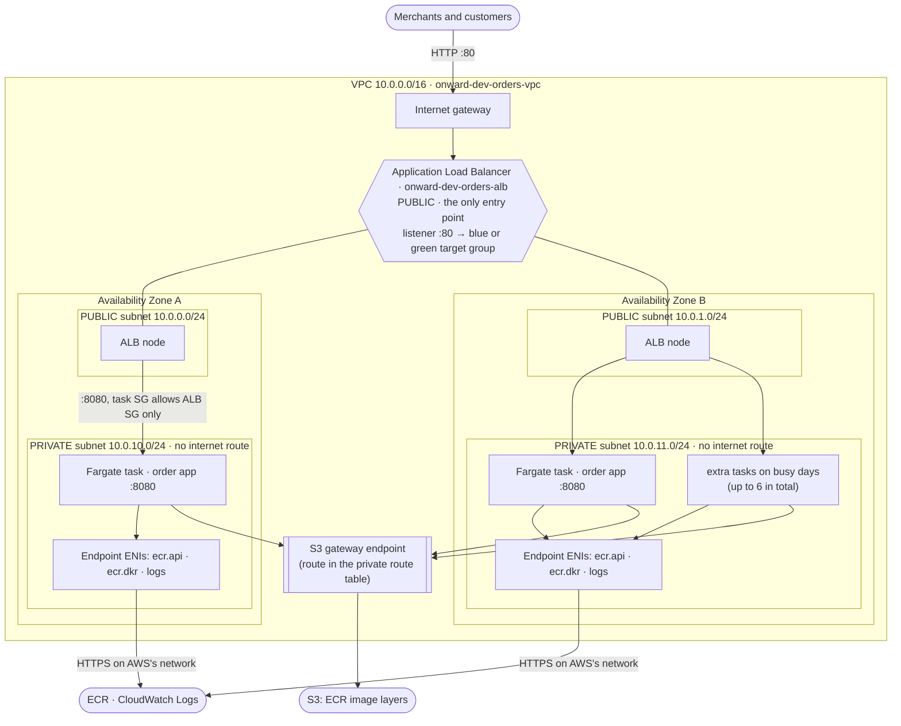
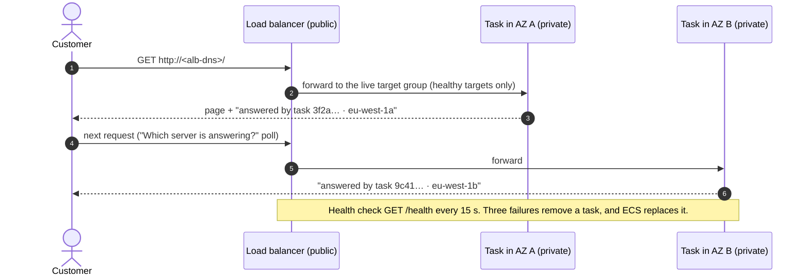
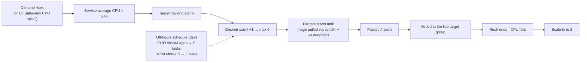

# Architecture: Delivering Order System Updates Safely

Region `eu-west-1`, environment `dev`. Read this page top to bottom: each section answers one question a new engineer will have.

The same design as an editable diagram: [`architecture.drawio`](architecture.drawio), [open in diagrams.net](https://app.diagrams.net/#Hjadofils%2Fweek-3-lab-2-aws-containerization%2Fmain%2Fdocs%2Farchitecture%2Farchitecture.drawio). Page 1 shows the VPC and runtime; page 2 shows the delivery pipeline and how a change flows.

## 1. The two repositories and the stacks

| Repository | Holds | Deployed by |
| --- | --- | --- |
| **Application** ([`week-3-lab-2-orders-app`](https://github.com/jadofils/week-3-lab-2-orders-app)) | `app/` (Spring Boot), `Dockerfile`, `.github/workflows/ci.yml` (CI) and `.github/workflows/build-and-push.yml` (CD) | GitHub Actions CI → CD → Amazon ECR → EventBridge → CodePipeline → CodeDeploy |
| **Infrastructure** ([`week-3-lab-2-aws-containerization`](https://github.com/jadofils/week-3-lab-2-aws-containerization)) | `infrastructure/` (CloudFormation), `docs/` | CloudFormation Git sync |

| Stack | Template → deployment file | What it creates | Why it is separate |
| --- | --- | --- | --- |
| `onward-dev-gitsync-bootstrap` | `infrastructure/bootstrap/gitsync-bootstrap.yaml` (console upload, once; no deployment file) | GitHub connection, Git sync role | Git sync cannot create the connection it depends on. |
| `onward-dev-registry` | `templates/1-registry.yaml` → `deployments/dev/1-registry.yaml` | ECR repository, GitHub OIDC provider, GitHub Actions role and push policy | An image must exist before ECS can start a service ([D3](../decisions/README.md#d3-layered-stacks-registry-first)). |
| `onward-dev-network` | `templates/2-network.yaml` → `deployments/dev/2-network.yaml` | VPC, subnets, route tables (private: no internet route), VPC endpoints, all security groups | Changes rarely; every traffic rule is readable in one file. |
| `onward-dev-service` | `templates/3-service.yaml` → `deployments/dev/3-service.yaml` | Task roles, ALB, blue/green target groups, listener, ECS cluster, task definition, service, auto scaling, budget | What customers reach and what runs. |
| `onward-dev-pipeline` | `templates/4-pipeline.yaml` → `deployments/dev/4-pipeline.yaml` | 5xx rollback alarm, artifact bucket, CodeDeploy, CodeBuild Prepare, CodePipeline, EventBridge rule | Release machinery; can change or be rebuilt without touching the network or the service. |

Paths are under `infrastructure/`. The design keeps its numbered sections across the stacks: **1 Network + 2 Private connectivity + 3 Security groups** (`network`) → **task identities + 4 Load balancer + 5 Service and scaling + 7 Cost guardrail** (`service`) → **6 Release pipeline** (`pipeline`).

Stacks share values through CloudFormation exports named `onward-dev-<stack>-<value>`, for example `onward-dev-network-vpc-id`. Create them in order (registry → network → service → pipeline) and delete them in reverse.

## 2. Resources inside the VPC: public vs private

| | Public | Private |
| --- | --- | --- |
| Resources | Application Load Balancer, internet gateway | Fargate tasks, interface endpoint network interfaces |
| Inbound from internet | ALB on port 80 only | **None.** Tasks have no public IP. The task security group admits only port 8080 from the ALB security group. |
| Outbound | n/a | **No internet route.** The private route table has only the local VPC route and the S3 gateway route. Tasks may send HTTPS only to the endpoint security group and the S3 prefix list. |
| Admin access | n/a | None needed. Logs are in CloudWatch. Tasks are replaced, never repaired. |

### Security groups

| Security group | Inbound | Outbound |
| --- | --- | --- |
| `onward-dev-orders-alb-sg` | TCP 80 from `0.0.0.0/0` | TCP 8080 to the VPC CIDR only (where the tasks are) |
| `onward-dev-orders-task-sg` | TCP 8080 from the ALB SG | TCP 443 to the endpoint SG and to the S3 prefix list (`S3PrefixListId`) |
| `onward-dev-orders-endpoint-sg` | TCP 443 from the task SG | none |

The S3 gateway endpoint's policy allows only `s3:GetObject` on the bucket where ECR stores image layers (`prod-eu-west-1-starport-layer-bucket`), so it can't be used to reach any other bucket.

## 3. How a request flows

## 4. How a change reaches customers

```mermaid
flowchart LR
  dev([Engineer merges PR to main<br/>application repository]) --> gha
  subgraph gh["GitHub"]
    gha["GitHub Actions<br/>CI: scan · mvn verify · image builds<br/>→ CD (only if CI passed): docker build + push"]
  end
  gha -->|"OIDC token → sts:AssumeRoleWithWebIdentity<br/>(no stored keys)"| ecr[("Amazon ECR · onward-dev-orders<br/>tags: sha-‹commit› + latest")]
  ecr -->|"ECR Image Action: PUSH SUCCESS, tag latest"| eb["EventBridge rule<br/>onward-dev-orders-image-pushed"]
  eb -->|StartPipelineExecution| src
  subgraph cp["CodePipeline V2 · onward-dev-orders-pipeline"]
    src["1 Source<br/>ECR action → imageDetail.json<br/>(image digest)"] --> prep["2 Prepare<br/>CodeBuild: taskdef.json + appspec.yaml"] --> dep["3 Deploy<br/>CodeDeploy ECS blue/green"]
  end
  dep --> green["Green tasks start<br/>and pass /health"] --> shift["10% of traffic for 5 min<br/>5xx alarm watching"] --> all["100% to green"] --> wait["Blue kept for 15 min<br/>(instant rollback window)"] --> done["Blue stopped"]
  shift -. alarm .-> rb["Automatic rollback<br/>traffic back to blue"]
```

Step by step:

1. **Merge.** On every push and pull request, **CI** (`ci.yml`) scans for credentials, runs the tests and checks that the image builds. It has no AWS access. Only when CI passes on `main` does it trigger **CD** (`build-and-push.yml`), which builds exactly the commit CI tested.
2. **Push.**
   - GitHub issues a short-lived OIDC token. AWS exchanges it for temporary credentials on `onward-dev-github-actions-role`.
   - The role trusts only `repo:jadofils@114186160/week-3-lab-2-orders-app@1460005073:ref:refs/heads/main` (GitHub's immutable subject: owner and repository names with their permanent numeric IDs).
   - The job pushes the image tagged `sha-<commit>` (immutable) and moves `latest` to it.
3. **Trigger.** ECR emits an *ECR Image Action* event. The EventBridge rule matches pushes of `latest` to `onward-dev-orders` and starts the pipeline through its own role.
4. **Source.** The ECR source action writes `imageDetail.json`. It contains the image **digest**, so the release is pinned even though `latest` will move later.
5. **Prepare.** A small CodeBuild project:
   - reads the latest registered revision of the task definition family `onward-dev-orders`;
   - sets its image to the `<IMAGE1_NAME>` placeholder and writes `taskdef.json`;
   - writes `appspec.yaml` (container `orders`, port 8080).
   CloudFormation therefore stays the owner of task size, roles and logging ([D8](../decisions/README.md#d8-the-pipeline-copies-the-task-definition-cloudformation-registered)).
6. **Deploy.** CodeDeploy registers a new task definition revision with the new digest and starts a green task set behind the idle target group. It shifts traffic with `CodeDeployDefault.ECSCanary10Percent5Minutes`, then stops blue 15 minutes later.

## 5. How a bad release is reversed

| When | What happens | How long |
| --- | --- | --- |
| Green fails its health checks | CodeDeploy never shifts traffic; the deployment fails and rolls back. Customers stay on blue. | Automatic |
| Errors rise during the canary | `onward-dev-orders-5xx-alarm` (target 5xx ≥ 5 in 1 minute) goes into alarm. CodeDeploy stops and sends all traffic back to blue. | Automatic, within about a minute |
| Problem noticed within 15 minutes of release | *CodeDeploy → deployment → Stop and roll back*. Blue is still running, so this is only a listener switch. | Seconds |
| Problem noticed later | *CodePipeline → Deploy stage → Start rollback*, choosing the last good execution. It redeploys that execution's image digest blue/green. | About 10 minutes |

## 6. How capacity changes

## 7. Failure behaviour

- **A container fails.** The ALB stops sending to it after three failed checks (about 45 seconds), and ECS starts a replacement.
- **A whole Availability Zone is lost.** Tasks, ALB nodes and endpoint interfaces exist in both zones. The surviving zone keeps answering, and ECS places replacement tasks there.
- **A release is bad.** See [section 5](#5-how-a-bad-release-is-reversed).
- **GitHub is down.** No new releases can be built. The running service is unaffected, because nothing at runtime depends on GitHub.

## Resource names

All names follow `onward-<environment>-<purpose>`. All resources carry the `Project`, `Owner` and `Environment` tags.

| Resource | Name |
| --- | --- |
| ECR repository | `onward-dev-orders` |
| GitHub Actions role / push policy | `onward-dev-github-actions-role` / `onward-dev-ecr-push-policy` |
| VPC | `onward-dev-orders-vpc` |
| ALB / target groups | `onward-dev-orders-alb` / `onward-dev-orders-blue-tg`, `onward-dev-orders-green-tg` |
| ECS cluster / service / task family / container | `onward-dev-orders-cluster` / `onward-dev-orders-service` / `onward-dev-orders` / `orders` |
| Log group | `/onward/dev/orders` |
| CodeDeploy application / deployment group | `onward-dev-orders-deploy` / `onward-dev-orders-dg` |
| CodeBuild project | `onward-dev-orders-prepare` |
| CodePipeline / artifact bucket | `onward-dev-orders-pipeline` / `onward-dev-orders-artifacts-<account-id>` |
| EventBridge rule | `onward-dev-orders-image-pushed` |
| Rollback alarm | `onward-dev-orders-5xx-alarm` |
